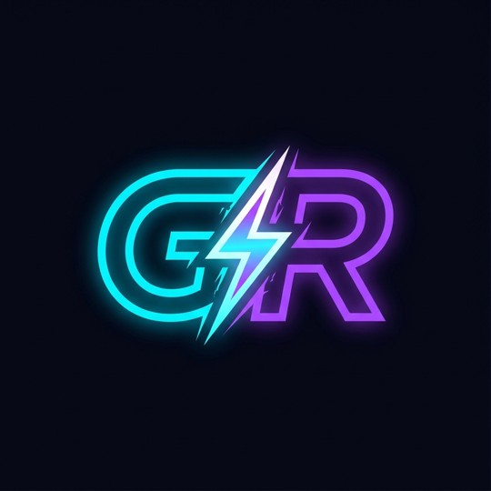
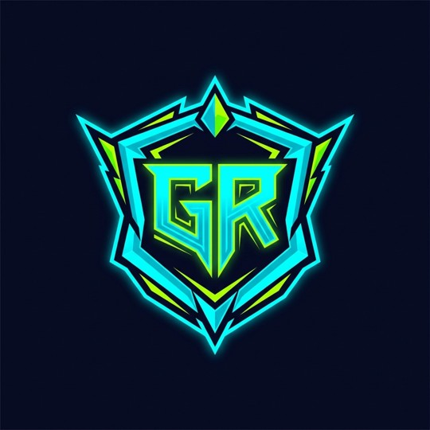

# 🎮 @gameplay.radical: kit de lançamento

> [!IMPORTANT]
> **Decidido em 16/11/2026:** ✅ **Logo 2** (controle + raio) · ✅ **Bio A**

| Item | Definição |
|---|---|
| **Usuário** | @gameplay.radical |
| **Logo** | ✅ Opção 2: controle + raio (verde-limão + roxo) |
| **Bio** | ✅ Opção A |
| **Nome de exibição** | Gameplay Radical \| Clipes de Games |
| **Tipo de conta** | Profissional, do tipo Criador de conteúdo |
| **Categoria** | Criador de vídeos de jogos (ou "Criador de conteúdo digital") |
| **Idioma** | Português (público BR) |
| **Cores** | fundo `#0B0B14` · roxo `#9B5CFF` · ciano `#00E5FF` · verde-limão `#B6FF00` |
| **Frequência** | De 1 a 3 Reels por dia |
| **Música** | Própria, gerada com IA (plano pago) |
| **Crédito** | `@criador` na legenda |

---

## 1. Logo

**[⬇️ Baixar a logo escolhida em alta resolução (1080×1080)](alta-resolucao/logo-escolhida.png)**

<div class="row"><figure><figcaption>✅ ESCOLHIDA: Opção 2, controle + raio</figcaption></figure><figure><figcaption>Opção 1: monograma GR com raio</figcaption></figure><figure><figcaption>Opção 3: emblema estilo esports</figcaption></figure></div>

| Opção | Comentário |
|---|---|
| ✅ **2: Controle + raio** | **Escolhida.** Comunica "games" na hora e é bem legível no círculo pequeno. Arquivo: `logo_v2.png` |
| 1: Monograma GR | Alternativa, caso queira reforçar o nome no futuro. |
| 3: Emblema esports | Tem detalhe demais para o tamanho do perfil. |

> [!TIP]
> Os arquivos em alta resolução (1080×1080) estão em `/root/canal-games/assets/` (`logo_v1.png`, `logo_v2.png`, `logo_v3.png`). O Instagram corta a foto em círculo: envie a imagem quadrada.

---

## 2. Nome de exibição

O nome de exibição também aparece na busca do Instagram, por isso inclui "Clipes de Games".

```text
Gameplay Radical | Clipes de Games
```

Alternativa:
```text
Gameplay Radical 🎮 Melhores Momentos
```

---

## 3. Bio (máx. 150 caracteres)

**✅ Opção A (ESCOLHIDA):** convida o público a mandar clipes, que chegam de graça e já com autorização.
```text
🎮 Os momentos mais RADICAIS dos games
💀 Fails, clutches e jogadas insanas todo dia
📩 Manda teu clipe na DM
👇 Ativa as notificações
```

**Opção B:** cria um compromisso fixo, que dá motivo para voltar.
```text
⚡ Só jogada insana, fail épico e momento absurdo
🎬 Clipe novo todo dia
🏆 Top 5 da semana toda sexta
📩 Envie seu clipe na DM
```

**Opção C:** curta e focada em compartilhamento.
```text
Clipes de game pra mandar pro seu duo 💀
🎮 Postagem diária
📩 DM: envie seu clipe ou parcerias
```

> [!NOTE]
> **Link na bio:** por enquanto não precisa. Quando tiver Discord, TikTok ou YouTube, use os "vários links" nativos do Instagram (até 5) ou um Linktree.

---

## 4. Checklist de configuração (nesta ordem)

- [ ] **Mudar para conta profissional, do tipo Criador de conteúdo.** Fica em Configurações › Tipo de conta e ferramentas. Libera estatísticas, agendamento e Trial Reels.
- [ ] Escolher a categoria **Criador de vídeos de jogos** e deixar visível no perfil
- [ ] Subir a **logo**, colar o **nome** e a **bio**
- [ ] Deixar a conta **pública** (conta privada não aparece no Explorar nem no Reels)
- [ ] Ativar a **autenticação de dois fatores** e confirmar e-mail e telefone. Páginas de clipes são alvo frequente de roubo de conta.
- [ ] Ligar à **Central de Contas** e abrir o **Meta Business Suite**, que agenda Reels de graça pelo computador
- [ ] Reservar **@gameplay.radical no TikTok e no YouTube**
- [ ] Criar uma **resposta rápida** para "como envio meu clipe" (Ferramentas para criadores › Respostas rápidas)
- [ ] **Aquecer a conta por 2 a 3 dias:** seguir de 20 a 30 páginas/streamers de games, curtir, comentar e assistir Reels do nicho. Não comprar seguidores.
- [ ] Publicar **6 a 9 Reels** antes de divulgar e **fixar 3**
- [ ] Criar os **destaques** (seção 5)
- [ ] Conferir **Configurações › Status da conta** toda semana

---

## 5. Destaques (stories fixados)


| Capa | Nome do destaque | Conteúdo |
|---|---|---|
| 🎬 Claquete | **Clipes** | Melhores da semana |
| 💀 Caveira | **Fails** | Os mais engraçados |
| 🏆 Troféu | **Top 5** | Rankings |
| 🎮 Controle | **Envie** | Como mandar seu clipe |
| 🤝 Aperto de mão | **Parcerias** | Contato comercial |

> [!TIP]
> Para criar um destaque é preciso ter postado pelo menos 1 story: poste a própria capa como story e salve no destaque. Os arquivos estão em `/root/canal-games/assets/highlight_*.png`.

---

## 6. Primeiros posts

| # | Post | Ideia | Fixar? |
|---|---|---|---|
| 1 | **Top 5 jogadas mais insanas da semana** | ~45 s, contagem regressiva 5→1, com a melhor por último | 📌 |
| 2 | **O fail mais engraçado que você vai ver hoje** | Clipe único de 10 a 15 s, texto "espera o final 💀" | 📌 |
| 3 | **Manda teu clipe e apareça aqui** | Montagem rápida + "quer ver tua jogada aqui? manda na DM 📩" | 📌 |
| 4 a 9 | Clipes únicos | Um momento forte por Reel, de 7 a 20 s | |

---

## 7. Modelo de legenda

```text
[frase curta que gera curiosidade] 💀

🎥 Clipe: @[criador]
🎮 Jogo: [nome do jogo]

Manda pro teu duo que faria isso 👇
📩 Manda teu clipe na DM

#[jogo] #clipesdegames #gameplay #gamerbrasil #momentosengraçados
```

**Hashtags (use de 3 a 5 por post):** `#clipesdegames` `#gameplay` `#gamerbrasil` `#gamesbr` `#momentosengraçados` `#fails` `#clutch` `#jogadainsana` `#[jogo]` `#[jogo]br`

> [!NOTE]
> A busca do Instagram dá mais peso às **palavras escritas na legenda** do que às hashtags. Escreva o nome do jogo e o tipo de clipe por extenso ("clutch de valorant", "fail no fortnite").

---

## 8. Rotina de postagem

| Horário | Tipo |
|---|---|
| **12h a 13h** | Clipe único curto (almoço) |
| **18h a 19h** | Clipe único ou fail |
| **21h a 22h** | Compilação / Top 5 (pico) |
| **Sexta 20h** | Top 5 da semana (fixo) |

Produzir em lote (de 10 a 15 Reels por sessão) e agendar tudo pelo **Meta Business Suite**. Isso é o que torna o canal automatizável.

> [!IMPORTANT]
> Lembretes: `@criador` sempre na legenda · só música própria (IA paga) · sem música comercial no áudio do clipe · checar **Status da conta** toda semana.
